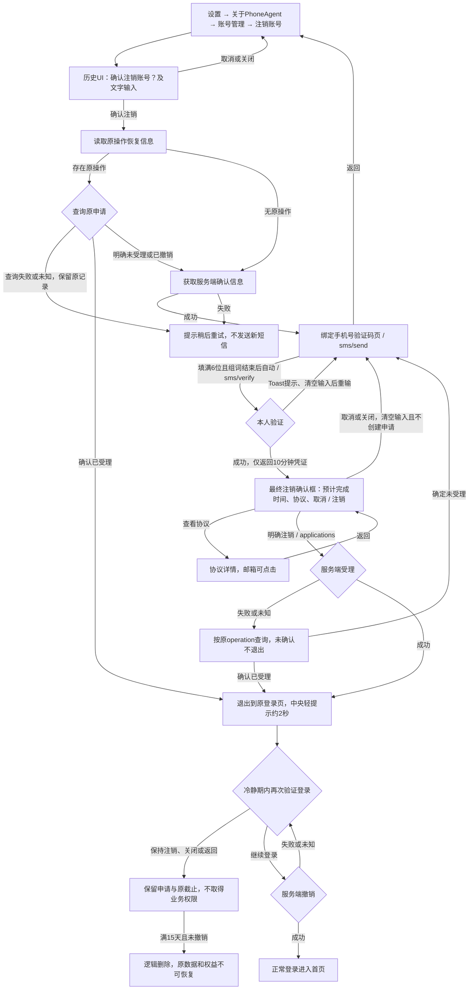

# 账号注销页面与接口流程（2026-10-27）

入口确认恢复历史弹窗完整UI，包含“确认注销”文字输入及脱敏账号；最终确认继续复用NativeBusinessDialog，无协议勾选框或文字输入。旧“验证码通过直接提交”的图已失效，以本图为准。15天从服务端实际受理成功起算，最终确认显示的是预计时间。

入口确认之前不读取注销恢复存储、不发任何注销接口请求。所有恢复和服务端准备均在明确确认之后；服务端失败不能阻止本地入口弹窗展示。

损坏或过期的本地恢复记录，只在当前账号的服务端ACTIVE确认成功后清理；查询失败的已知原操作始终保留。

验证码页正常流程无验证/继续注销主按钮，所有操作反馈使用现有Toast。重新发送按服务端resendCooldownSeconds倒计时禁用，归零可点；重发成功清空输入并绑定新挑战。验证失败及取消最终确认清输入，重输完整6位才重新验证，不循环重试。申请未知保留查询原结果入口，受理后退出屏障保持。
